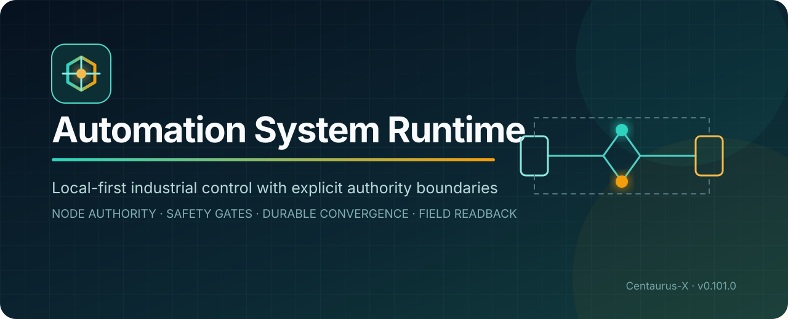
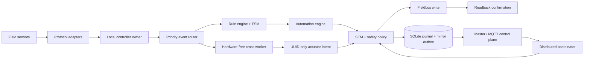
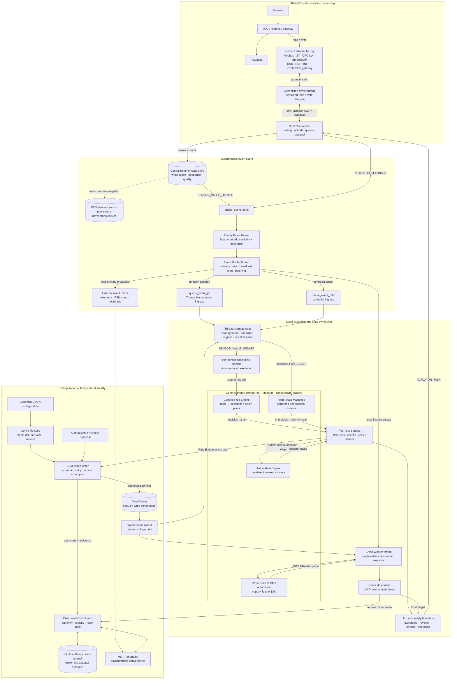
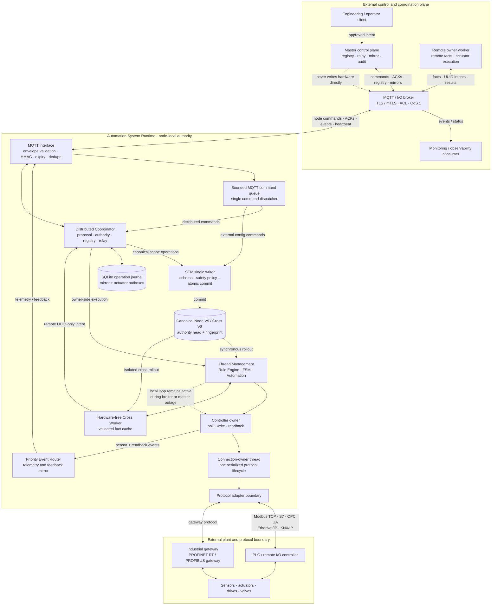

# Automation System Runtime

<p align="center">
  
</p>

<p align="center">
  <strong>A local-first, distributed industrial automation runtime for deterministic control, explicit authority boundaries and resilient field operation.</strong>
</p>

<p align="center">
  <a href="https://github.com/Centaurus-X/Automation_System_Runtime/actions/workflows/quality.yml"></a>
  <a href="https://github.com/Centaurus-X/Automation_System_Runtime/releases"></a>
  
  
  <a href="LICENSE"></a>
</p>

<p align="center">
  <a href="README.de.md">Deutsch</a> ·
  <a href="#quick-start">Quick start</a> ·
  <a href="docs/ARCHITECTURE.md">Architecture</a> ·
  <a href="docs/DEPLOYMENT.md">Deployment</a> ·
  <a href="docs/TECHNICAL_ASSESSMENT.md">Technical assessment</a> ·
  <a href="SECURITY.md">Security</a>
</p>

---

## Why this exists

Industrial control should not stop merely because a broker, coordinator or
control-plane connection is unavailable. Automation System Runtime keeps the
sensor, rule, state-machine, automation, safety and hardware-I/O path local to
the worker while using the distributed layer for registry, relay, mirroring
and audit.

This release is the result of several years of iterative engineering. Its
central design principle is deliberately conservative: **the node that owns
the field hardware remains the final authority for its node shard**.

## Who it is for

- Industrial automation and OT engineers evaluating local-first control.
- System integrators connecting Modbus, S7, OPC UA and other field protocols.
- Platform teams designing resilient worker/control-plane boundaries.
- Security engineers reviewing mTLS, fencing, fail-closed configuration and
  auditable state transitions.
- Researchers testing free-threaded Python for parallel control workloads.

## What you can achieve

- Keep local automation active during master or MQTT-broker outages.
- Apply configuration changes through one atomic, safety-authorized commit boundary.
- Coordinate cross-node logic without giving the cross runtime direct hardware access.
- Persist authority heads, journals, mirror outboxes and runtime values across restarts.
- Route actuator intent back to the hardware owner and require a matching readback before confirmation.
- Run deterministic regression tests without requiring a complete physical plant.

## Technical highlights

| Capability | Engineering value |
|---|---|
| Node-local authority | Field control does not wait for a remote master commit. |
| Authority V5 fencing | Authority, scope and execution epochs reject stale owners and stale work. |
| SEM single writer | External, file-based and runtime changes converge on one verified commit path. |
| Durable convergence | SQLite journal and mirror outbox preserve asynchronous control-plane convergence. |
| Isolated cross runtime | Cross rules coordinate nodes but never write field hardware directly. |
| Safety gates | Path, principal, revision, value-limit and interlock checks fail closed. |
| Secure MQTT boundary | TLS/mTLS, optional HMAC, expiry, deduplication and retained-command rejection. |
| Adapter architecture | Modbus TCP, S7/TIA, OPC UA, EtherNet/IP, KNX/IP, PROFINET RT and PROFIBUS-gateway boundaries. |
| Reproducible release | Versioned contracts, internal SHA-256 manifest, release validation and SBOM. |

> [!IMPORTANT]
> This is a **pre-production, technically validated release snapshot**. It is
> not independently safety-certified, real-time-certified or declared compliant
> with IEC 61508, IEC 62443, NIS2 or any other regulatory framework. Validate
> the complete system, hazards and timing on your own target environment before
> controlling real equipment.

## Architecture at a glance



The detailed ownership model, startup/shutdown order, data flow and failure
semantics are documented in [Architecture](docs/ARCHITECTURE.md).

<details>
<summary><strong>Explore the internal component architecture and event flow</strong></summary>

> GitHub renders this diagram with its native Mermaid viewer. The standalone
> source is available as
> [`runtime-internal-components.mmd`](docs/diagrams/runtime-internal-components.mmd).



The diagram follows the implemented queues and ownership rules: pool workers
operate on detached inputs, results return through a dedicated result queue,
FSM events remain serialized per process instance, and only controller owners
reach a protocol connection. SEM owns configuration mutation; actuator writes
pass a separate ownership, revision, fencing and interlock boundary.

</details>

<details>
<summary><strong>Explore the external communication and gateway architecture</strong></summary>

> GitHub renders this diagram with its native Mermaid viewer. The standalone
> source is available as
> [`runtime-external-communications.mmd`](docs/diagrams/runtime-external-communications.mmd).



The external plane is deliberately asynchronous. The Master and MQTT/I/O
broker distribute intent, registry state and evidence, while the owner Worker
resolves UUIDs to its canonical local bus coordinates and performs the final
safety check, fieldbus write and readback. Broker or Master loss degrades
convergence and remote coordination, not the already-authorized local loop.

</details>

## Quick start

### Requirements

- Linux for the supported deployment path.
- Python 3.12 for the portable regression suite.
- CPython 3.14 free-threaded for the documented production qualification path.
- `openssl` for TLS validation tests and mTLS identity installation.
- `PyYAML==6.0.3` from `requirements.txt`.

```bash
git clone https://github.com/Centaurus-X/Automation_System_Runtime.git
cd Automation_System_Runtime

python3 -m venv .venv
. .venv/bin/activate
python -m pip install --upgrade pip
python -m pip install -r requirements.txt

chmod 0755 run_worker.sh install_mqtt_identity.sh test_all.sh
./test_all.sh

AUTOMATION_PROFILE=standalone ./run_worker.sh --preflight
```

> [!WARNING]
> Do not start a hardware-enabled profile until you have reviewed
> `_config/application/app_config.yaml` and the selected node configuration.
> The supplied `standalone` and `worker_simulation` profiles allowlist the
> packaged simulator endpoint at `192.168.0.3:5020`.

For mTLS installation, distributed profiles and systemd operation, follow the
[deployment guide](docs/DEPLOYMENT.md).

## Runtime profiles

| Profile | Distributed | MQTT | Field I/O | Intended use |
|---|---:|---:|---:|---|
| `unit_test` | No | No | No | Deterministic test execution. |
| `standalone` | No | No | Yes | Autonomous local runtime after explicit config review. |
| `worker_simulation` | Yes | Yes | Yes, allowlisted simulator | Distributed integration and lab validation. |
| `worker_fn02` | Yes | Yes | Yes, node-specific | Second hardware-owner shard. |
| `local_dev` | No | No | Disabled by datastore settings | Local component development. |
| `master_prod` | Legacy profile | Legacy WebSocket path | Configuration-dependent | Compatibility only; not the documented MQTT worker path. |

## Validation and evidence

Release `v0.101.0` includes:

- 54 independently executable Python test files in the recorded Linux release validation.
- Contract Authority `2.0`, Type Schema `2.0.0`, Node Storage V9 and Cross Storage V8.
- A 191-entry internal SHA-256 release manifest, verified before publication.
- A source SBOM in SPDX 2.3 format.
- Recorded clean-room qualification on CPython 3.14.6t with mTLS/MQTT and a Modbus simulator.
- The original byte-exact release archive and its SHA-256 sidecar attached to the GitHub release.

These are project-maintained engineering records, not independent
certification. See [Release Validation](RELEASE_VALIDATION_V0101.md) and the
[publication assessment](docs/TECHNICAL_ASSESSMENT.md) for scope and caveats.

## Performance model

The runtime is designed to remove remote coordination from the local control
critical path, isolate controller owners, batch fieldbus operations and use a
priority-aware event router plus configurable worker pools. The release does
**not** publish a universal latency or throughput claim because fieldbus,
controller, workload, interpreter and hardware dominate the result.

Read [Performance](docs/PERFORMANCE.md) for measurable paths, tuning controls
and a target-system benchmark plan.

## Repository map

```text
src/                         runtime implementation
  adapter/                   fieldbus and PLC boundaries
  core/                      authority, coordination, routing and thread ownership
  interfaces/                MQTT transport boundary
  library/                   contracts, rule/FSM/automation and persistence primitives
  system/                    bootstrap, preflight, lifecycle and metrics
test/                        54 executable regression files
_config/                     profiles, node/cross contracts and certificate boundary
_documentation/              release-era technical documentation
_tools/                      validation, conversion, packaging and service utilities
docs/                        publication architecture, deployment and assessment
```

## Known boundaries

- Linux is the supported deployment environment; Windows is useful for partial static/regression checks but is not the qualified runtime target.
- The production qualification record targets CPython 3.14t; the public CI regression uses mainstream Python 3.12.
- Optional protocol backends are loaded only when selected and require their own vendor/community dependencies. Only PyYAML and optional `python-snap7` are pinned in this snapshot.
- No Docker image, Kubernetes manifest or turnkey control plane is included.
- The SBOM declares the core runtime and PyYAML but does not enumerate every optional adapter backend.
- No quantitative end-to-end latency, jitter or throughput guarantee is made.
- Safety-policy examples are not a substitute for plant-specific hazard analysis, interlocks or independent validation.

## Documentation

- [Architecture](docs/ARCHITECTURE.md)
- [Deployment](docs/DEPLOYMENT.md)
- [Performance](docs/PERFORMANCE.md)
- [Dependency model](docs/DEPENDENCIES.md)
- [Technical assessment](docs/TECHNICAL_ASSESSMENT.md)
- [Runtime documentation index](_documentation/README.md)
- [MQTT runtime integration](_documentation/MQTT_RUNTIME_INTEGRATION.md)
- [Authority V5 diagnosis](DIAGNOSE_AUTHORITY_V5_V0101_DE.md)
- [Release notes](RELEASE_NOTES_V0101_DE.md)
- [Release validation](RELEASE_VALIDATION_V0101.md)
- [Original v0101 release README](docs/ORIGINAL_RELEASE_README_V0101.md)

## Security

Please do not disclose vulnerabilities in public issues. Use GitHub private
vulnerability reporting as described in [SECURITY.md](SECURITY.md). Never
commit credentials, client certificates, private keys or live plant data.

## Contributing

Start with [CONTRIBUTING.md](CONTRIBUTING.md). The codebase intentionally uses
a functional style: no classes, decorators, lambdas or type annotations. Use
`functools.partial()` when binding callables and preserve the explicit
single-writer and ownership boundaries.

## Licensing and commercial engineering

The community release is available under [GNU GPL v3.0 only](LICENSE). A
separate commercial license and engineering support can be discussed for
organizations that require different terms, integration, architecture review,
hardening, deployment or validation. See
[Commercial Licensing](COMMERCIAL_LICENSE.md).

For an initial conversation, open a
[GitHub Discussion](https://github.com/Centaurus-X/Automation_System_Runtime/discussions)
without confidential details. Sensitive material should only be exchanged
after a private channel has been agreed.

---

<p align="center">
  Built with patience, explicit failure behavior and respect for the machines
  that ultimately execute the decision.
</p>
